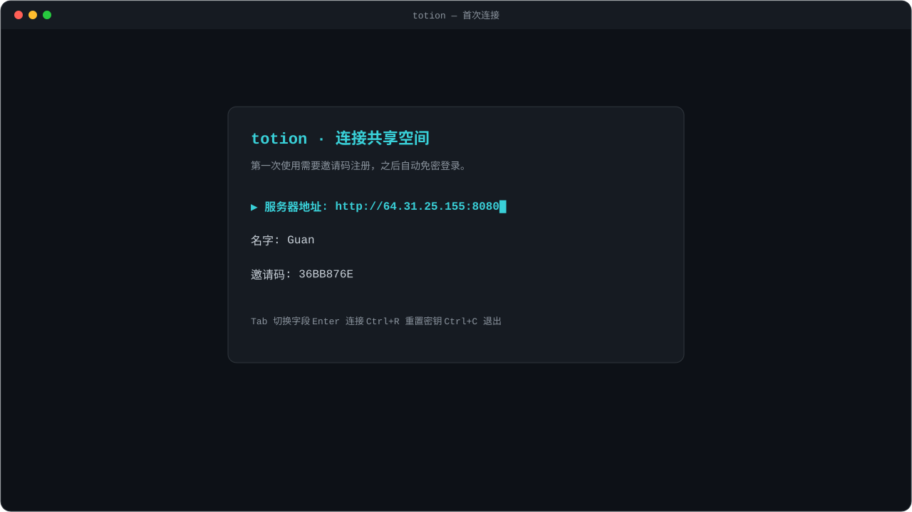
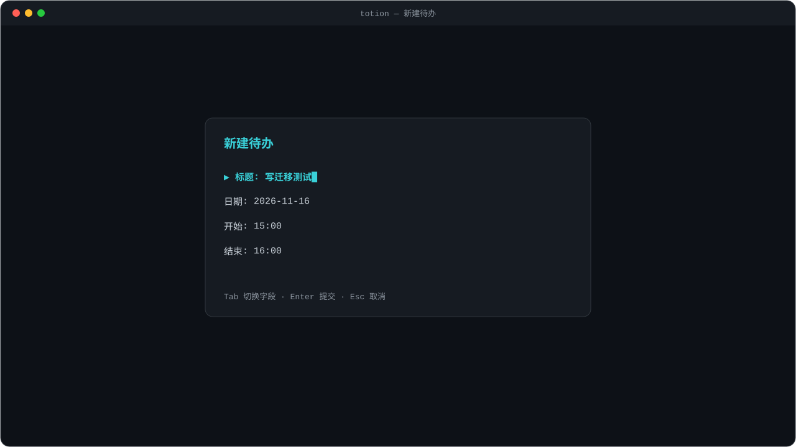
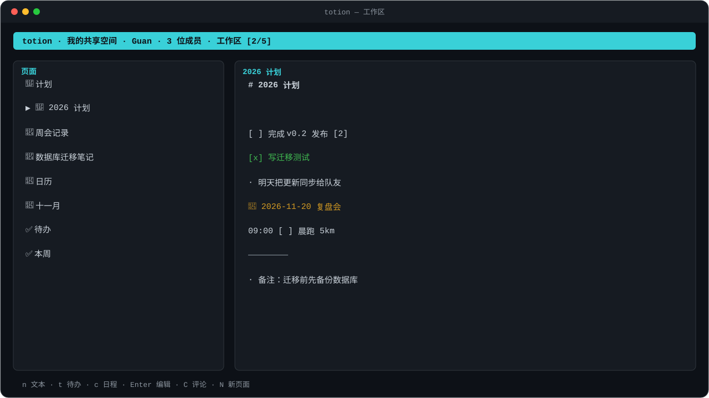
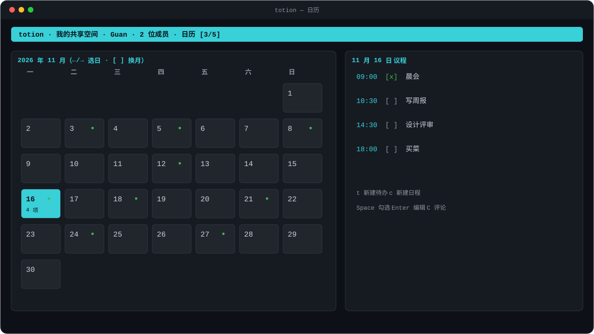
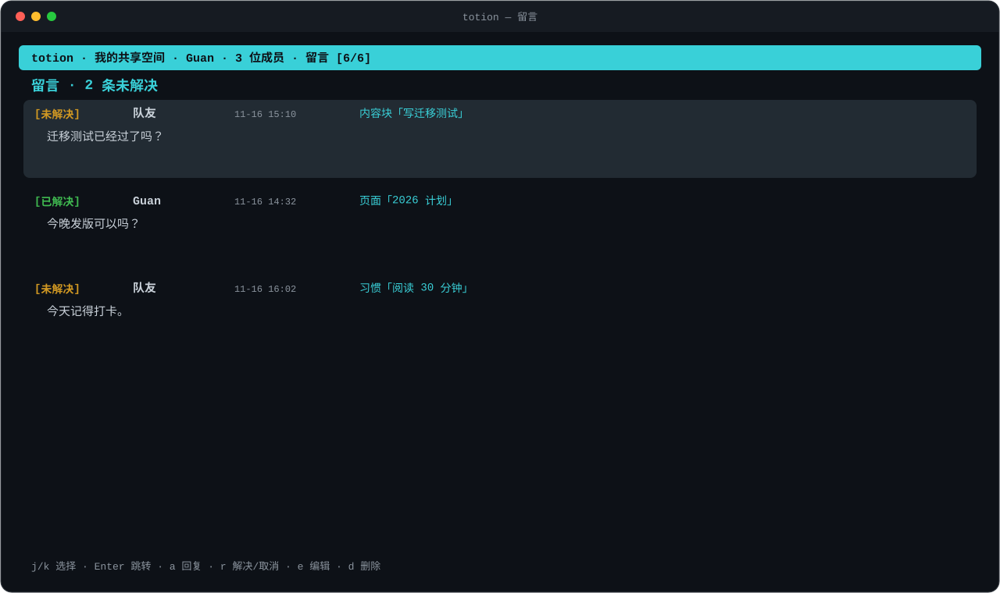
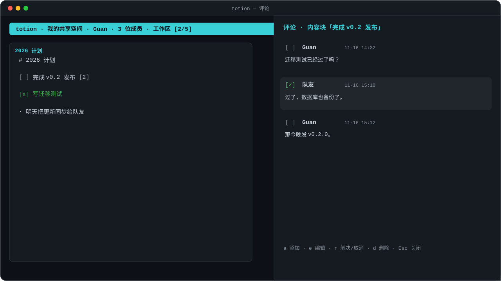
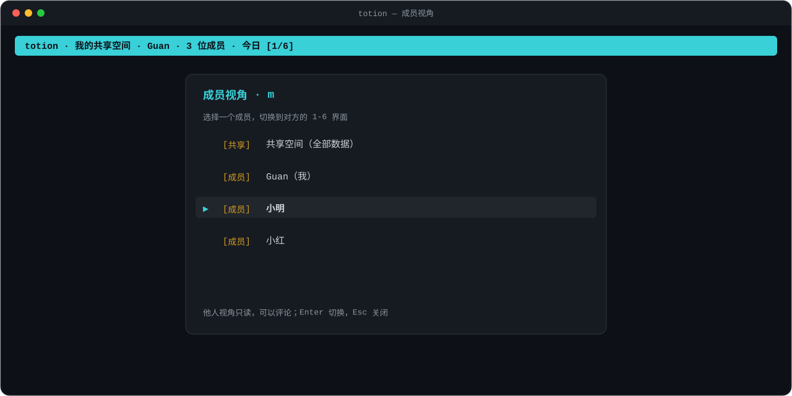
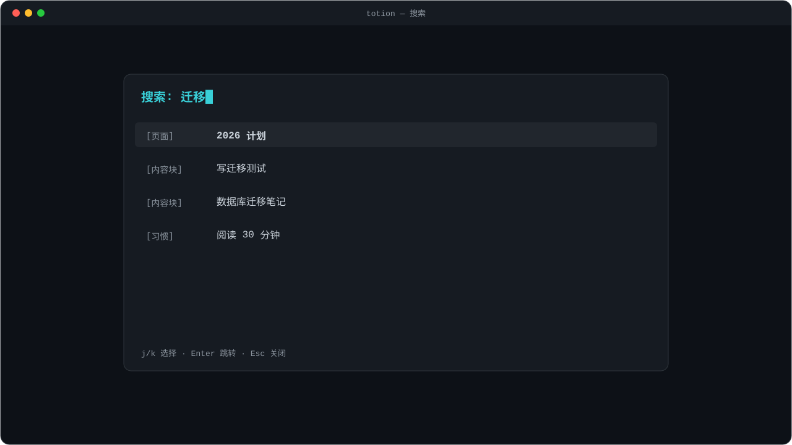
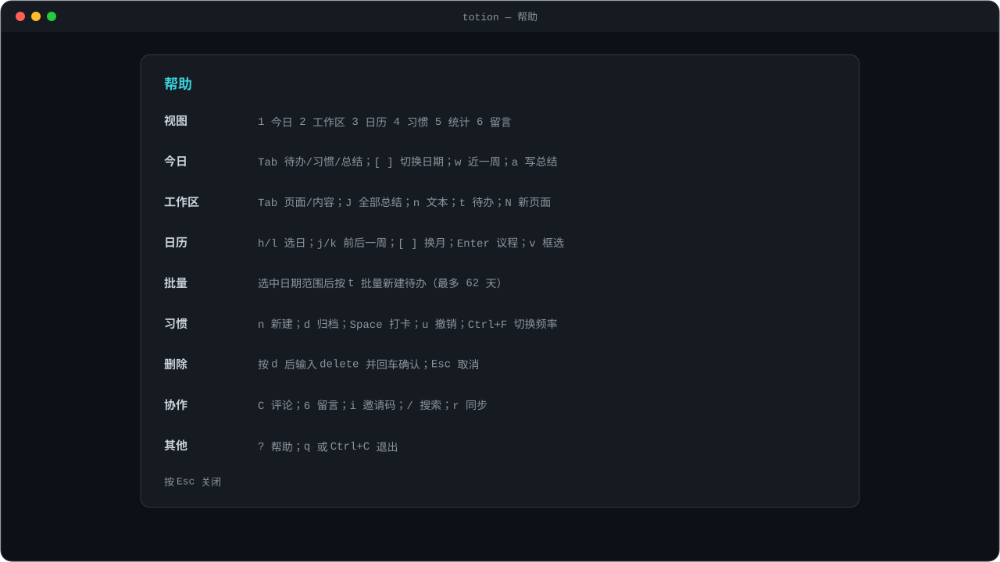
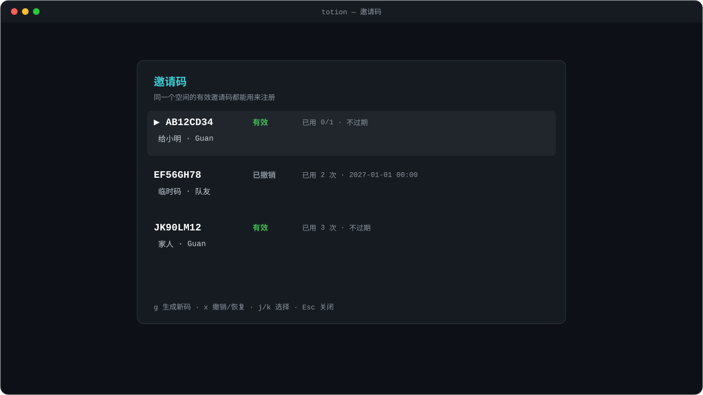

<p align="center">
  
</p>

<p align="center">
  <a href="https://github.com/wzdbxxzy/totion/actions/workflows/ci.yml"></a>
  <a href="https://github.com/wzdbxxzy/totion/releases"></a>
  <a href="LICENSE"></a>
  
  
</p>

totion 是一个跑在终端里的共享清单工具。待办、习惯、日历、总结和留言放在同一个空间里，多人共用一份数据，每个客户端每 2 秒自动同步。

它由两部分组成：一个单文件的 TUI 客户端（Rust + ratatui），和一个自托管的同步服务（Rust + axum + SQLite）。没有账号系统，不依赖云服务，数据就是一个 SQLite 文件。

适合几个人一起用：一个共享空间、一组邀请码，谁都能加待办、打卡、写总结、留评论。技术上没有成员数量上限，目前按小规模使用设计，没有角色和权限区分。

## 安装

### 直接下载

从 [Releases](https://github.com/wzdbxxzy/totion/releases) 下载：

| 系统 | 文件 |
|------|------|
| Windows 10/11 x64 | `totion-x86_64-pc-windows-msvc.zip` |
| macOS Apple Silicon | `totion-aarch64-apple-darwin.tar.gz` |
| macOS Intel | `totion-x86_64-apple-darwin.tar.gz` |
| Linux x64 | `totion-x86_64-unknown-linux-gnu.tar.gz`（含客户端和服务端） |

Windows：

```powershell
Expand-Archive .\totion-x86_64-pc-windows-msvc.zip -DestinationPath .\totion
cd .\totion
.\totion.exe
```

macOS / Linux：

```bash
tar -xzf totion-*.tar.gz
./totion
```

第一次运行时，Windows 可能提示 SmartScreen，点“更多信息 → 仍要运行”；macOS 可能提示无法验证开发者，执行一次：

```bash
xattr -d com.apple.quarantine ./totion
```

### 从源码编译

需要 Rust 1.85 或更新的 stable 版本：

```bash
git clone git@github.com:wzdbxxzy/totion.git
cd totion
cargo build --release -p totion-client
```

编译出的程序在 `target/release/totion`（Windows 是 `totion.exe`）。

## 第一次使用

### 1. 准备服务器

如果已经有人给你了地址，直接跳到下一步。自己部署的话，在服务器上启动：

```bash
./totion-server --bind 0.0.0.0:8080 --data-dir ./data
```

第一次启动会生成邀请码，保存在 `data/invite_code`：

```bash
cat data/invite_code
```

以后部署、升级、开机自启见[部署](#部署)。

### 2. 启动客户端

```bash
./totion
```

第一次运行会进入连接界面：

<p align="center">
  
</p>

- `Tab` 在三个输入框之间切换。
- 填服务器地址、你的名字、邀请码。
- `Enter` 连接。

连接成功后，客户端会生成一对 Ed25519 密钥，保存在：

- Windows：`%APPDATA%\totion\identity.json`
- macOS：`~/Library/Application Support/totion/identity.json`
- Linux：`~/.config/totion/identity.json`

以后启动会直接用私钥签名登录，不需要再填密码。如果密钥丢失，可以用 `Ctrl+R` 在连接界面重新生成，但重新生成后会以一个新成员加入。

### 3. 邀请其他人

把服务器地址发给其他人，邀请码不要公开发。在客户端按 `i` 打开邀请码面板，按 `g` 生成一个新码，把码单独发给对方。任意有效邀请码都能加入同一个空间，数据完全共享。

服务器首次启动的初始邀请码只用于让第一个成员进来；建议进来后自己生成新码，并把初始码撤销。

### 4. 进入今日

连接后默认进入「今日」，并自动创建当天的页面。顶部显示日期和完成率。

<p align="center">
  
</p>

今日分成三个面板：左边是当天的待办，右边是今天该做的习惯，底部是当天的一条总结。按 `Tab` 在三个面板间切换，当前面板的边框会亮起。完成的项前面是绿色 `✓`，未完成是灰色 `○`。

## 界面说明

### 今日

今日有三个面板，按 `Tab` 在「待办 / 习惯 / 总结」之间切换，当前面板边框会高亮。选中的条目前面有 `▶`，并加背景和加粗。

- `h` / `l`（或 `[` / `]`、方向键左右）查看前一天 / 后一天，标题会显示「昨天」「前天」；`w`（或 `W`）打开周视图，逐日列出每天的全部待办和完成率，不显示总结和评论，底部显示整周完成情况（如「本周 12/20 60%」）；周视图里 `j` / `k` 选日，`h` / `l` 前后平移一天，`Enter` 跳到某一天。
- `t` 新建待办，会弹出表单：

  <p align="center">
    
  </p>

  填标题、日期、开始和结束时间（`HH:MM`），`Tab` 切换字段，`Enter` 保存。

- `g` / `G`（或 `Home` / `End`）跳到当前列表的第一条 / 最后一条；日历里 `g` 回到今天。
- `Space` 勾选当前待办；切到习惯面板时是打卡，已打卡再按一次取消。
- `u` 撤销今天某个习惯的打卡；查看历史日期时只能看，不能打卡。
- `a` 写总结。总结附着在当前选中的待办或习惯上；切换条目时下方总结会跟着切换，当前对象没有总结时总结面板自动隐藏。只有选中待办/习惯时才显示总结，其他时候隐藏。
- `Enter` 编辑当前待办或总结。
- `d` 请求删除当前待办、习惯或总结，会弹出「确定要删除⋯⋯吗？」的确认框，需要输入 `delete` 并回车才执行。
- 右下角显示当前条目的未解决评论，没有评论时隐藏。
- 总结支持多行：`Enter` 换行，`Ctrl+S` 保存，`Esc` 取消；`↑` / `↓` 按行移动光标，`Home` / `End` 到当前行首/行尾。

所有待办都挂在当天的页面上，带日期和时间；日历和统计里也能看到。在日历里给今天安排的待办，会自动出现在这里。

### 工作区

<p align="center">
  
</p>

左边是页面列表，按类型分组（文档、计划、习惯、待办、日历），页面多时列表自动滚动，当前分组标题会固定在顶部。右边上半是选中页面的内容块，下半常驻「全部总结」，进入工作区就能看到今日和其它日期写过的总结，不需要额外按键。

- `j` / `k` 移动，`Tab` 在页面列表和内容块之间切换。
- `N` 新建页面。
- `n` 新建文本块，`t` 新建待办块。
- `Enter` 编辑页面标题或内容块。
- `Space` 勾选待办块。
- `d` 请求删除（需要输入 `delete` 确认）。
- `J` 打开全屏「全部总结」列表：这里汇总所有附着在待办/习惯上的总结；`j` / `k` 选择，`e` 编辑，`d` 删除，`J` 或 `Esc` 返回。右侧下半的预览区始终可见。
- 选中一个待办块时，内容块列表下方会显示它的总结。
- `a` 显示或隐藏自动生成的每日页面，默认隐藏，避免页面列表被每天的页面占满。
- 顶部 `[数字]` 表示该页面或内容块有未解决的评论。

### 日历

<p align="center">
  
</p>

日历占满屏幕。顶部是带季节标记的月份横幅（例如 🍁 十一月 · 待办 12 · 完成 8），每个日期格子带边框，直接显示当天的待办摘要；放不下时会截断成省略号。月历首尾会灰显相邻月份的日期，点一下就能跳过去。日历里只显示待办，不显示总结。

- 今天用绿色标记，过去日期用暗色，未来日期保持正常配色；选中的日期是青色。
- `h` / `l` 选择前一天、后一天，`j` / `k` 选择前一周、后一周。
- `[` / `]` 切换月份。
- `Enter` 或双击日期格子打开选中日期的议程（查看、勾选、编辑、删除）。
- `t` 新建待办。

**批量安排一段日期**：

1. 按 `v` 设置范围起点（再按一次取消），然后移动光标扩展范围；
2. 或者按住 `Shift` 用右键从起点拖到终点框选；
3. 选好范围后按 `t` 批量创建待办，每天一条，最多 62 天。

格子里 `✓` 表示已完成，`○` 表示未完成。

### 习惯

<p align="center">
  
</p>

左边是习惯列表，右边是选中习惯的详情。热力图会按终端宽度自动显示更多周数，终端越宽看到的记录越长。

- 习惯的**新建和删除只在这个界面进行**：`n` 新建，`d` 删除；今日和日历只能打卡，不能创建/删除习惯。
- `n` 新建习惯。表单里按 `Ctrl+F` 在“每天 / 工作日 / 每周 N 次”之间切换。
- `Space` 今天打卡，再按一次取消；`u` 也可以撤销今天的打卡。
- `e` 修改习惯名称。
- 右侧显示连续天数、最长连续、30 天完成率、打卡热力图，以及这个习惯的历史总结列表。
- 删除习惯是**归档**：以后的日子不再出现在今日/习惯列表，但历史打卡和总结都保留。在习惯界面按 `A` 可以查看已归档习惯，选中后按 `R` 恢复；归档习惯不能打卡。
- `d` 删除习惯同样需要输入 `delete` 确认。

习惯和待办是分开的：待办通常只做一次，习惯可以持续打卡。每次打卡都会单独记录，所以能看历史，而不是只保留一个连续天数。

### 统计

<p align="center">
  
</p>

- 最上面是今天的完成率。
- 中间是最近 14 天的完成数量和完成率趋势。
- 下面是最近 16 周的打卡热力图，以及每个习惯的连续天数和 30 天完成率。
- `h` / `l` 在 7 / 14 / 30 / 90 天窗口之间切换。

### 留言

按 `6` 打开留言视图，这里汇总所有评论，直接显示正文，不需要先打开某个对象：

<p align="center">
  
</p>

- 未解决的评论排在前面，显示作者、时间、评论对象和完整正文。
- `j` / `k` 选择，`Enter` 跳转到对应的页面 / 内容块 / 习惯。
- `a` 直接回复（在该对象下新增评论）。
- `r` 标记解决 / 取消解决，`e` 编辑，`d` 删除。

### 评论

在任意界面选中一个页面、内容块或习惯，按 `C` 打开评论面板：

<p align="center">
  
</p>

- `a` 添加评论（多行，`Ctrl+S` 保存）。
- `j` / `k` 选择，`e` 编辑，`r` 标记为已解决 / 取消已解决，`d` 删除。
- `Esc` 关闭。

评论按时间排列，显示作者和时间；评论较多时列表会自动滚动到选中项，标题显示当前范围。未解决的评论会在对象旁边显示数量。

### 成员视角

按 `m` 打开成员列表，选择某个成员后，1-6 界面会切换成「他的视角」：今日只显示他的待办和习惯，日历、统计、留言也只看他的数据。每次打开面板会向服务器刷新一次成员列表，别人新加入后不用重启客户端。

<p align="center">
  
</p>

- 顶部标题栏显示「视角：张三（只读，可评论）」，`m` 可随时切换。
- 他人的视角只读：勾选、编辑、删除、新建都会被拦下并提示；但按 `C` 仍可以在他的待办或习惯下评论。
- 列表第一项「共享空间」回到所有人的数据，和之前完全一样。
- 归属按创建者记录。升级前的老数据没有创建者，只能按最后修改人近似归属，可能不准确。

### 鼠标

键盘不是必须的，大部分跳转都能点：

- 顶部导航栏：点 `1 今日` … `6 留言` 切换界面；右侧的 `m 成员`、`i 邀请`、`/ 搜索`、`? 帮助`、`r 同步` 也能点。
- 今日：点 `‹` / `›` 切换日期，点 `[周视图]` 打开周视图，点待办/习惯行选中，点前面的 `✓` / `○` 直接勾选或打卡，点面板空白处切换焦点。
- 工作区：点页面或内容块选中，点右下角总结预览打开「全部总结」。
- 习惯、留言、周视图：点列表行选中。
- 日历：点日期格子选日，双击格子打开当天议程，点月份两侧的 `‹` `›` 换月，`Shift + 右键` 拖动框选范围。
- 编辑框、弹窗里的输入仍用键盘。
- 滚轮：在列表或弹窗里滚动等同于 `j` / `k`，直接上下移动选中项。

### 搜索和帮助

`/` 打开搜索，输入关键词会实时匹配页面标题、内容块文本和习惯名称：

<p align="center">
  
</p>

`j` / `k` 选择，`Enter` 跳转，`Esc` 关闭。

`?` 打开快捷键帮助（`j` / `k` 或滚轮滚动，`Esc` 关闭）：

<p align="center">
  
</p>

编辑和输入状态下，`Esc` 取消，`Enter` 保存（多行内容用 `Ctrl+S`）。

## 桌面面板（实验）

Windows 上可以把整套 TUI 放进屏幕右侧的毛玻璃侧栏，固定在桌面：

```powershell
cargo run --release -p totion-client --bin totion-glass
# 或者下载 Release 里的 totion-glass.exe
```

- 面板占据屏幕右侧约 38% 宽度（可用 `--width 38` 调，范围 33–50），高度铺满工作区。
- 整块面板是分层窗口的半透明画布，壁纸会透出来；配色统一映射成暖白极简风，和浅色/动漫壁纸更搭。
- 内部就是完整的 TUI：`1`–`6` 切换界面、`j/k` 移动、`Space` 勾选、`C` 评论、`i` 邀请码、`/` 搜索、`?` 帮助、`q` 退出，和终端版一致。
- 点击面板获得焦点后即可用键盘；面板内的点击（标签、列表、日期、勾选框）和滚轮都会转发给 TUI；右键退出。
- 鼠标悬停在可点击区域时会轻微提亮并变成手型光标；内容四周留出内边距，顶部略深、底部略透。
- 字体优先 Sarasa Mono SC 18px，其次 NSimSun / Consolas；按中文半宽计算单元格，字距和行高更接近终端。
- `--opacity 150` 调整不透明度（60–235，越小越透）；`--topmost` / `--no-topmost` 切换是否置顶。
- 这些偏好会记在 `%APPDATA%	otion\glass.json`，下次启动自动沿用；传参时覆盖并写回。
- 复用客户端已经保存的身份（`%APPDATA%	otion\identity.json`），第一次需要先运行 `totion` 连接服务器。
- 内置壁纸命令：`totion-glass --wallpaper "D:\壁纸\wallpaper.jpg"`。
- 仅 Windows 可用；macOS / Linux 上运行会提示不支持。

## 邀请码

邀请码只决定“谁能注册进来”。注册后所有成员共享同一份数据，没有独立空间。

<p align="center">
  
</p>

- 任意界面按 `i` 打开邀请码面板。
- `g` 生成新码，`x` 撤销或恢复，`j` / `k` 选择，`Esc` 关闭。
- 同一个空间可以有多个有效邀请码，任何一个都能注册。
- 服务器 CLI 也能生成：`./totion-server --data-dir ./data --new-invite "给小明"`。
- 初始码保存在 `data/invite_code`；环境变量 `TOTION_INVITE_CODE` 可以把初始码固定下来。
- 不要把邀请码提交到仓库、贴到公开 issue 或截图里。泄露后按 `x` 撤销，撤销不影响已注册成员。

## 同步与协作

- 服务端记录所有变更（谁、什么时候、改了什么），客户端每 2 秒按游标拉取一遍。断网后恢复会自动追上，不需要手动操作；断网期间状态栏显示「同步失败 · 将自动重试」。
- 页面和内容块带版本号。两个人同时改同一条时，后提交的一方会收到冲突，客户端自动刷新成最新版本并在底部提示，不会静默覆盖。
- 顶部显示当前成员数；别人改动页面、内容块、习惯、总结或评论时，底部会出现提示。
- 所有人共用一个空间，没有角色和权限区分。邀请码决定谁能注册，任意有效码都进入同一空间；泄露后按 `i` 撤销即可。
- 待办和习惯会记录创建者；按 `m` 可以切换到某位成员的视角查看他的 1-6 界面，他人视角只读但可以评论。

## 架构

<p align="center">
  
</p>

服务端是一个 axum 应用，所有数据在一个 SQLite 文件里：

- 写操作在事务内同时写实体和变更日志，避免只写一半。
- `GET /api/sync?since=N&limit=M` 返回一批变更和下一个游标，客户端循环拉到 `has_more=false`。
- 登录是 Ed25519 挑战-应答：客户端用本地私钥签一个 nonce，服务端验签后发会话 token，不传密码。
- 数据模型包括页面、内容块、习惯、打卡记录、评论和总结；数据库结构由 `schema_version` 驱动迁移，启动时重复执行也不会出错。

客户端是 ratatui 界面，所有操作先写本地状态，再同步到服务端；遇到冲突用服务端返回的当前对象刷新本地。

## 开发

```bash
cargo test --workspace

# 服务端
cargo run -p totion-server -- --data-dir ./dev-data --bind 127.0.0.1:8080

# 另一个终端
cargo run -p totion-client
```

首次启动服务端后，邀请码在 `dev-data/invite_code`。

提交前跑一遍：

```bash
cargo fmt --all
cargo clippy --workspace --all-targets -- -D warnings
cargo test --workspace
```

Windows 上没有 MSVC 工具链时，可以用 GNU 工具链编译：

```bash
export PATH="/c/Users/hasee/scoop/apps/mingw/current/bin:$PATH"
cargo +stable-x86_64-pc-windows-gnu run -p totion-client
```

目录结构：

```
crates/totion-core/     共享类型、协议、统计与日期函数
crates/totion-server/   axum 服务、SQLite、迁移、变更日志
crates/totion-client/   ratatui TUI
docs/                   README 截图与架构图
deploy/                 systemd 单元模板
.github/workflows/      CI 与 Release
scripts/                截图生成脚本
```

## 部署

推荐用 systemd 管理服务。仓库里的 `deploy/totion.service` 是模板，把 `__DEPLOY_USER__` 和 `__DEPLOY_HOME__` 替换成实际用户和目录：

```ini
[Service]
User=admin
Group=admin
WorkingDirectory=/home/admin/totion
EnvironmentFile=-/home/admin/totion/totion.env
ExecStart=/home/admin/totion/totion-server
Restart=on-failure
```

`totion.env` 里至少要有：

```bash
TOTION_BIND=0.0.0.0:8080
TOTION_DATA_DIR=/home/admin/totion/data
TOTION_INVITE_CODE=你的邀请码
```

推送到 `main` 会跑 CI；打 `v*` tag 会构建三个平台的客户端、发布 Release，并把服务端部署到配置好的机器：

1. 上传新二进制为 `totion-server.new`
2. 停服务
3. 备份 `data/totion.db*`
4. 替换二进制、安装 systemd 单元
5. 启动并检查 `/api/health`

部署需要的 GitHub Secrets：

| Secret | 内容 |
|--------|------|
| `DEPLOY_HOST` | 服务器地址 |
| `DEPLOY_USER` | SSH 用户 |
| `DEPLOY_SSH_KEY` | 部署私钥 |
| `TOTION_INVITE_CODE` | 可选，初始邀请码（不是唯一码） |

服务器上的文件：

```
~/totion/
  totion-server
  totion.env
  data/totion.db
  data/totion.db.bak.<时间戳>   每次部署自动备份
  data/invite_code
```

## 常见问题

**连不上服务器**

先在服务器上 `curl http://127.0.0.1:8080/api/health`。本机通、外面不通，通常是云厂商安全组没放行端口。客户端提示服务器版本过旧，说明服务端需要升级到对应版本。

**邀请码在哪里**

服务端 `data/invite_code`，或者部署时设置的 `TOTION_INVITE_CODE`。已经在空间里的成员也可以在登录后看到服务器地址和成员数。

**按 `j` / `k` 时弹出中文输入法**

这是终端和输入法层面的行为。v0.8.1 起，客户端在传统 Windows 控制台里会在非编辑状态解绑输入法，编辑或首次连接时再恢复。如果用的是 Windows Terminal，输入法由终端自己管理，客户端无法关闭，需要按 `Shift` 或 `Ctrl+空格` 把输入法切到英文；写总结时再切回中文。

**怎么确认客户端是不是新版本**

运行 `totion --version`，或在客户端里按 `?` 打开帮助，标题会显示版本号。旧版本没有 `h` / `l` 切日期和删除确认框，升级到对应 Release 即可。

**数据存在哪，怎么备份**

全部在 `data/totion.db`。停服务后复制这个文件即可；`data/totion.db.bak.*` 是每次部署自动生成的备份。

**能不能公网使用**

可以，但当前默认是 HTTP，token 和内容会明文传输。建议在前面加 Caddy 或 Nginx 配一个域名和自动证书，客户端把地址改成 `https://` 即可，代码不用改。

**多人同时改同一个内容块会怎样**

后提交的一方会收到冲突，客户端刷新成最新内容并在底部提示。目前是块级最后写入，不是逐字合并；多人同时编辑同一段文字时，建议各自改不同块。

**适合多少人用**

当前按小规模设计，小团队（2-5 人）用最舒服。成员更多也能用，但没有角色、权限和成员管理功能。

## Roadmap

- [x] v0.1：页面 / 内容块、Ed25519 登录、增量同步、三平台 Release
- [x] v0.2：每日总结页、独立习惯与打卡历史、日历时间、统计图表、评论、搜索
- [x] v0.3：总结实体与汇总列表、全屏日历与日期范围框选、留言视图、自适应热力图
- [x] v0.4：多邀请码（生成 / 撤销 / 次数 / 过期）、邀请码面板
- [x] v0.5：统一待办、今日 Tab 三面板、单条总结、日历格子与月份标记、动态快捷键
- [x] v0.6：今日日期浏览 / 近一周、总结附着对象、评论预览、删除确认、日历配色、习惯归档
- [x] v0.7：h/l 切日期、今日焦点化快捷键、工作区常驻全部总结、更明确的删除确认、帮助显示版本
- [x] v0.8：成员视角（按 `m` 查看某人的 1-6 界面，他人视角只读可评论）、待办/习惯归属与 v5 迁移
- [x] v0.9：可点击的顶部导航栏、列表/日期/面板鼠标选中、周视图内容与翻页
- [x] v0.10：滚轮与双击、勾选框点击、`g`/`G` 跳转、长列表滚动、状态栏淡出、弹窗统一、搜索结果可读化
- [x] v0.11：页面/总结/成员/邀请码滚动、sticky 分组、相邻月份、多行编辑光标与横向滚动、离线状态、草稿保留、`r`/`Esc` 按键冲突修复
- [x] v0.12：归档习惯查看/恢复、周统计、成员列表刷新、`Home`/`End`，以及实验性桌面卡片 `totion-glass`
- [ ] 桌面面板：Acrylic 真模糊、鼠标点击与位置记忆（已有实验版 `totion-glass`）
- [ ] 一键 HTTPS 部署（Caddy 自动证书）
- [ ] 提醒与桌面通知
- [ ] Markdown / CSV 导出
- [ ] 成员管理与只读成员
- [ ] 移动端只读 Web 视图

## 贡献

欢迎 issue 和 PR。提交前确保 `cargo fmt --all`、`cargo clippy --workspace --all-targets -- -D warnings`、`cargo test --workspace` 都通过。细节见 [CONTRIBUTING.md](CONTRIBUTING.md)。

安全问题请不要公开提交 issue，见 [SECURITY.md](SECURITY.md)。

## License

[MIT](LICENSE)
