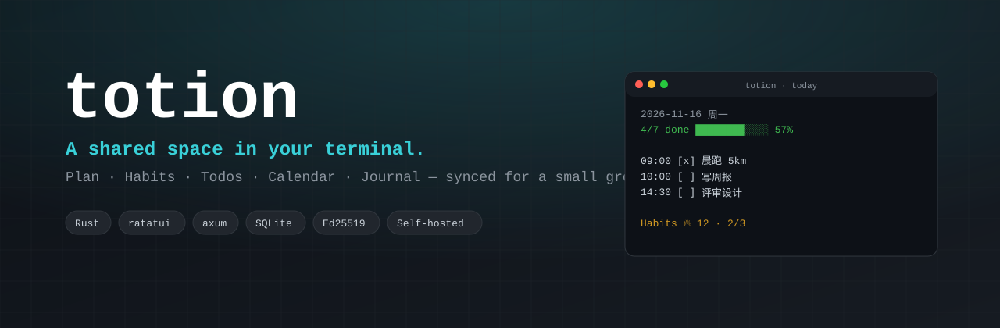
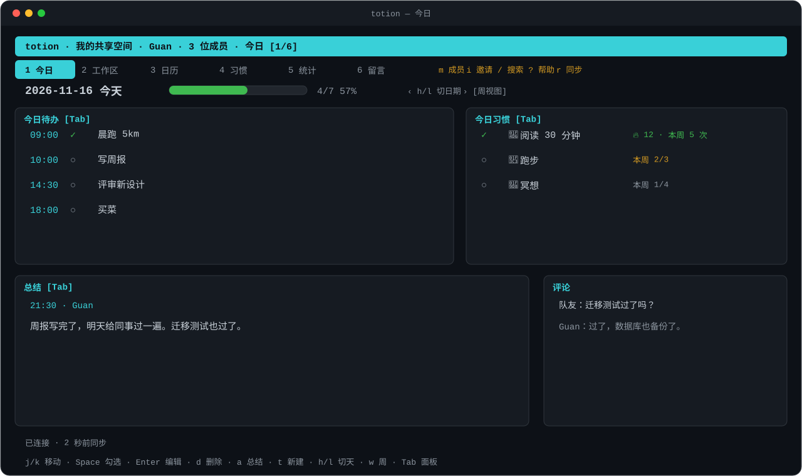
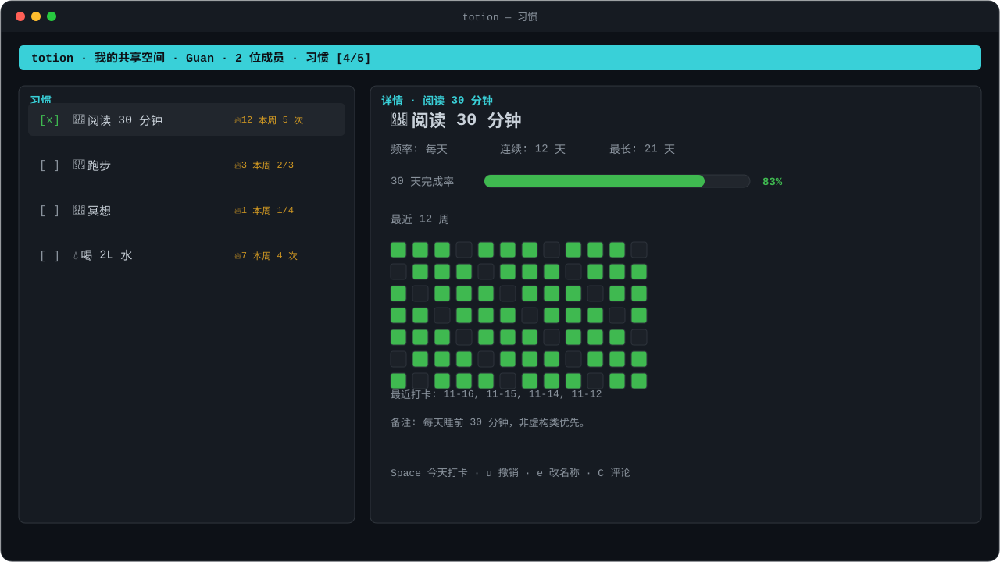
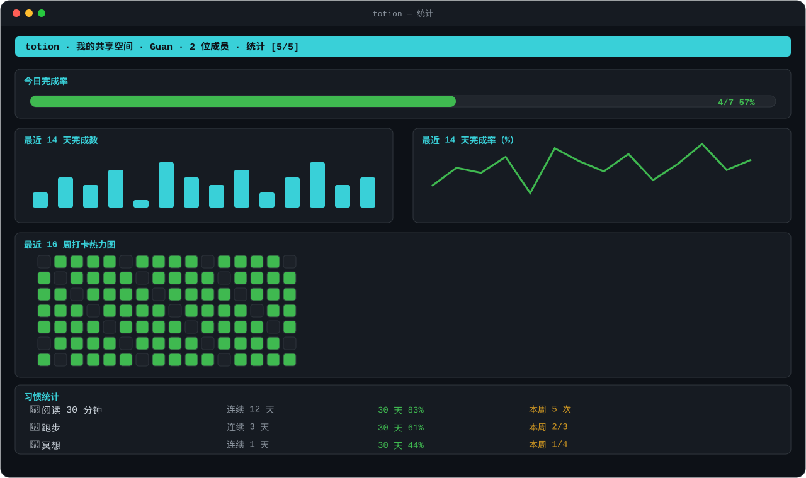
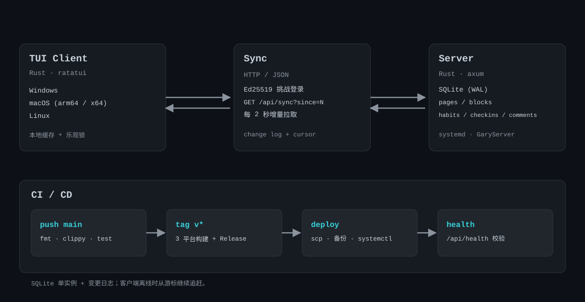

<p align="center">
  
</p>

<h3 align="center">终端里的双人共享空间：计划 · 习惯 · 待办 · 日历 · 日记</h3>

<p align="center">
  <a href="https://github.com/wzdbxxzy/totion/actions/workflows/ci.yml"></a>
  <a href="https://github.com/wzdbxxzy/totion/releases"></a>
  <a href="LICENSE"></a>
  
  
  
</p>

<p align="center">
  <a href="#-为什么是-totion">为什么</a> ·
  <a href="#-截图">截图</a> ·
  <a href="#-功能">功能</a> ·
  <a href="#-安装">安装</a> ·
  <a href="#-快速开始">快速开始</a> ·
  <a href="#-使用">使用</a> ·
  <a href="#-架构">架构</a> ·
  <a href="#-开发">开发</a> ·
  <a href="#-部署与-cicd">部署</a> ·
  <a href="#-roadmap">Roadmap</a>
</p>

---

## ✨ 为什么是 totion

浏览器里的协作工具很多，但「随手记一笔、打个卡、看今天该做什么」这件事，键盘和终端更快。

totion 是一个**自托管的终端共享空间**：

- **两个人一个空间**：共用一个邀请码加入，所有内容实时（2 秒）同步。
- **终端原生**：Rust + ratatui，单个二进制，Windows / macOS / Linux 都能跑。
- **免密登录**：Ed25519 密钥挑战-应答，没有密码可泄露。
- **数据在自己手里**：一个 SQLite 文件，一条 `systemctl` 管理，自动备份。

## 📸 截图

<p align="center">
  
</p>

<details>
<summary><b>习惯 · 日历 · 统计</b>（点击展开）</summary>

<br>

<p align="center">
  
  
  
</p>

</details>

> 截图由 `scripts/gen-readme-assets.py` 生成，与真实 TUI 布局一致。

## 🧩 功能

| 模块 | 能力 |
|------|------|
| **今日** | 自动创建每日日记页；当天待办/日程按时间排序；习惯打卡；「总结 / 感悟 / 经验」三个记录区；顶部完成率 |
| **工作区** | Notion 式页面 + 内容块（文本、标题、待办、旧版习惯、日程、分割线） |
| **日历** | 月历 + 选中日议程；`HH:MM` 时间；在任意日期新建待办/日程 |
| **习惯** | 独立于待办的坚持性任务；每天 / 工作日 / 每周 N 次；打卡历史、连续天数、最长连续、30 天完成率、12 周热力图 |
| **统计** | 今日完成率、最近 7/14/30/90 天完成柱状图与完成率趋势、汇总热力图、每个习惯的统计表 |
| **评论** | 页面 / 内容块 / 习惯都能评论；作者、时间、已解决状态；可编辑、删除 |
| **搜索** | `/` 搜索页面标题、内容块文本、习惯名称并跳转 |
| **同步** | 全局变更日志 + 游标分页；块级乐观锁，冲突返回 `409` 并自动刷新 |
| **认证** | 邀请码注册 + Ed25519 挑战-应答免密登录，会话 30 天 |
| **多端** | Windows x64、macOS arm64/x64、Linux x64 |

## 📦 安装

### 下载二进制

从 [Releases](https://github.com/wzdbxxzy/totion/releases) 下载对应平台：

| 平台 | 文件 |
|------|------|
| Windows x64 | `totion-x86_64-pc-windows-msvc.zip` |
| macOS Apple Silicon | `totion-aarch64-apple-darwin.tar.gz` |
| macOS Intel | `totion-x86_64-apple-darwin.tar.gz` |
| Linux x64 | `totion-x86_64-unknown-linux-gnu.tar.gz`（含客户端与服务端） |

```bash
# macOS / Linux
tar -xzf totion-*.tar.gz
./totion
```

### 从源码构建

需要 Rust stable 1.85+：

```bash
git clone git@github.com:wzdbxxzy/totion.git
cd totion
cargo build --release -p totion-client
./target/release/totion
```

## 🚀 快速开始

### 1. 启动服务器

```bash
cargo run --release -p totion-server -- \
  --bind 0.0.0.0:8080 \
  --data-dir ./data
```

首次启动会生成邀请码：

```bash
cat data/invite_code
```

### 2. 连接客户端

```bash
./totion
```

首次进入设置界面，填写：

| 字段 | 示例 |
|------|------|
| 服务器地址 | `http://127.0.0.1:8080` |
| 名字 | 你的名字（对方会看到） |
| 邀请码 | `cat data/invite_code` 的结果 |

按 `Enter` 连接。客户端会生成 Ed25519 密钥并保存到 `%APPDATA%\totion\identity.json`（Linux/macOS 为 `~/.config/totion/identity.json`），之后自动免密登录。

### 3. 邀请对方

把服务器地址和**同一个邀请码**发给对方，注册后即进入同一空间。

> 本仓库有一个演示部署：`http://64.31.25.155:8080`。生产使用请务必配置 HTTPS（见[安全](#-安全)）。

## ⌨️ 使用

### 视图

| 键 | 视图 | 说明 |
|----|------|------|
| `1` | 今日 | 待办 / 日程 / 习惯 / 日记 |
| `2` | 工作区 | 页面与内容块 |
| `3` | 日历 | 月历 + 日程 |
| `4` | 习惯 | 习惯列表 + 热力图 |
| `5` | 统计 | 图表与习惯统计 |

### 常用按键

| 键 | 作用 |
|----|------|
| `j` `k` / `↑` `↓` | 移动 |
| `Tab` | 工作区切换页面/内容面板 |
| `h` `l` / `←` `→` | 日历选日、统计切换窗口 |
| `[` `]` | 日历换月 |
| `Enter` / `e` | 编辑 |
| `Space` | 勾选待办 / 习惯打卡 |
| `u` | 撤销今天的打卡 |
| `t` / `c` / `n` | 新建待办 / 日程 / 习惯（按视图） |
| `N` | 新建页面 |
| `C` | 评论面板 |
| `/` | 搜索 |
| `?` | 帮助 |
| `r` | 手动同步 |
| `d` | 删除 |
| `q` / `Ctrl+C` | 退出 |

编辑时 `Enter` 保存；日记、评论等多行内容用 `Ctrl+S` 保存、`Enter` 换行、`Esc` 取消。

评论面板：`a` 添加 · `e` 编辑 · `r` 解决/取消 · `d` 删除 · `j/k` 选择 · `Esc` 关闭。

## 🏗 架构

<p align="center">
  
</p>

**服务端**（`crates/totion-server`）

- axum 0.8 + SQLite（WAL），单实例、进程内串行写。
- 所有写操作在事务内完成「实体写入 + 追加 changes」，避免半写状态。
- `GET /api/sync?since=N&limit=M` 返回本批最后一条 `seq` 与 `has_more`，客户端循环追赶，不丢变更。
- 旧客户端（`X-Totion-Protocol: 1`）只收到 `page/block`，新实体不会让它解析失败。
- 迁移由 `meta.schema_version` 驱动，启动时幂等执行。

**客户端**（`crates/totion-client`）

- ratatui 0.29 + crossterm，单二进制。
- 每 2 秒按游标增量同步；写操作失败或冲突时用服务端 `current` 刷新本地。
- 今日页由 `POST /api/days/{date}/ensure` 幂等创建，服务端唯一索引兜底。

**认证**

```
客户端                             服务端
  │  POST /api/auth/challenge        │
  │ ───────────────────────────────▶ │  生成 nonce（5 分钟内有效）
  │ ◀─────────────────────────────── │
  │  用本地 Ed25519 私钥签名 nonce    │
  │  POST /api/auth/verify           │
  │ ───────────────────────────────▶ │  验签，签发 30 天会话 token
```

## 🛠 开发

### 本地运行

```bash
cargo test --workspace

# 服务端
cargo run -p totion-server -- --data-dir ./dev-data --bind 127.0.0.1:8080
# 另一个终端
cargo run -p totion-client
```

> Windows 无 MSVC Build Tools 时，可用 GNU 工具链：
> ```bash
> export PATH="/c/Users/hasee/scoop/apps/mingw/current/bin:$PATH"
> cargo +stable-x86_64-pc-windows-gnu run -p totion-client
> ```

### 检查

```bash
cargo fmt --all -- --check
cargo clippy --workspace --all-targets -- -D warnings
cargo test --workspace
```

### 目录结构

```
crates/
  totion-core/     共享类型、协议、日期与统计纯函数
  totion-server/   axum 服务、SQLite、迁移、变更日志
  totion-client/   ratatui TUI（二进制 totion）
docs/              README 素材（banner、截图、架构图）
deploy/            systemd 单元模板
.github/workflows/ CI 与 Release
scripts/           README 素材生成脚本
```

## 🚢 部署与 CI/CD

- **CI**（`.github/workflows/ci.yml`）：push / PR 时跑 `fmt`、`clippy -D warnings`、`test`。
- **Release**（`.github/workflows/release.yml`）：推送 `v*` tag 后：
  1. 矩阵构建 Linux / macOS arm64+x64 / Windows x64；
  2. 生成 `SHA256SUMS.txt` 并发布 GitHub Release；
  3. 部署服务端：上传 `totion-server.new` → 停服务 → 备份 SQLite → 替换 → 安装 systemd → 启动 → 健康检查。

服务器目录：

```
~/totion/
  totion-server        当前二进制
  totion.env           环境变量（600）
  data/totion.db       SQLite
  data/totion.db.bak.* 每次部署前自动备份
  data/invite_code     邀请码
```

需要配置的 GitHub Secrets：

| Secret | 说明 |
|--------|------|
| `DEPLOY_HOST` | 服务器地址 |
| `DEPLOY_USER` | SSH 用户 |
| `DEPLOY_SSH_KEY` | 部署私钥 |
| `TOTION_INVITE_CODE` | 可选，固定邀请码 |

发版：

```bash
git tag v0.2.1 && git push origin v0.2.1
```

## 🗺 Roadmap

- [x] **v0.1** 页面 / 内容块、Ed25519 登录、增量同步、三平台 Release
- [x] **v0.2** 每日日记页、独立习惯与打卡历史、日历时间、统计图表、评论、搜索
- [ ] HTTPS 一键部署（Caddy / 自动证书）
- [ ] 桌面通知与今日提醒
- [ ] Markdown / CSV 导出
- [ ] 多空间与成员权限
- [ ] 移动端只读 Web 视图
- [ ] 更细粒度的协同（字段级合并 / CRDT 调研）

## 🤝 贡献

欢迎 issue 和 PR。提交前请确保：

1. `cargo fmt --all`
2. `cargo clippy --workspace --all-targets -- -D warnings`
3. `cargo test --workspace`

细节见 [CONTRIBUTING.md](CONTRIBUTING.md)。

## 🔒 安全

- 登录使用 Ed25519 挑战-应答；服务器只保存公钥和会话 token。
- 邀请码决定谁能加入空间，泄露后请更换（`TOTION_INVITE_CODE`）并清理会话。
- **当前默认部署是明文 HTTP**：token 和内容会在公网裸传。生产环境请在前面加 TLS（Caddy/Nginx），客户端把地址改成 `https://`。
- 安全问题请私下联系维护者，不要直接开公开 issue。

## 📄 License

[MIT](LICENSE) © 2026 wzdbxxzy

## 🙏 致谢

- [ratatui](https://github.com/ratatui-org/ratatui) / [crossterm](https://github.com/crossterm-rs/crossterm) —— 终端界面
- [axum](https://github.com/tokio-rs/axum) / [tokio](https://github.com/tokio-rs/tokio) —— 服务端
- [rusqlite](https://github.com/rusqlite/rusqlite) —— 嵌入式数据库
- [ed25519-dalek](https://github.com/dalek-cryptography/ed25519-dalek) —— 免密登录
- [serde](https://github.com/serde-rs/serde) / [chrono](https://github.com/chronotope/chrono) / [reqwest](https://github.com/seanmonstar/reqwest)
